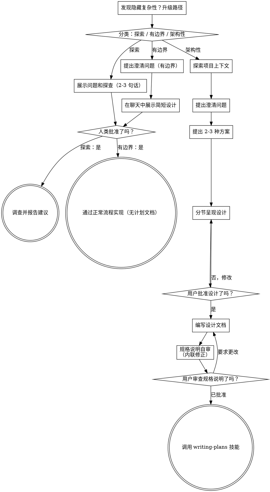

# 通过头脑风暴将想法转化为设计

通过自然的协作式对话，帮助将想法转化为完整成形的设计和规格说明。

先判断请求需要多少流程，再沿着对应路径推进：了解上下文、完善想法、展示设计，并获得人类伙伴的批准。

<HARD-GATE>
在你告知人类伙伴打算做什么并获得批准之前，不得调用任何实现技能、编写任何代码、搭建任何项目脚手架或采取任何实现行动。以下每条路径上的每项任务都适用——流程仪式会随任务调整，但批准关卡永远不会取消。
</HARD-GATE>

## 三条路径

在提出第一个问题之前先分类，并大声说出分类——例如“这看起来是有边界的任务，所以我会在这里展示一个简短设计，而不是写规格说明”——让人类伙伴可以推翻你的判断：

- **探索（Spike）**——可行性问题（“能不能……”“是否可能……”“快速粗糙地做也可以”），产出是答案而不是要保留的代码。用 2-3 句话说明问题和尝试方式，得到同意后，以正确性允许的最低成本进行探查。不写设计文档或规格文件。把发现报告为建议；构建的任何内容都必须标记为一次性产物。
- **有边界（Bounded）**——对本仓库已有代码的范围明确的改动：新标志、小端点、单文件修复。仅仅理解应用类型还不够——有边界意味着要修改的流程已经存在且可供阅读。如果没有可修改的现有流程，任务就不是有边界的。提出关键澄清问题，在对话中展示简短设计（几句话到几段短文），然后停止。只有人类伙伴明确同意设计后才能实现；不写规格文件或实现计划文档。
- **架构性（Architectural）**——新项目、新子系统、改变组件关系或其他人依赖的接口。走完整流程：提问、方案、分节设计、书面规格说明，然后调用 writing-plans 技能。

如果在两条路径之间犹豫，选择较重的路径。这个棘轮只能向上：任务中途发现隐藏复杂性时，停止、说明情况并升级路径；不会中途降级。

## 反模式：“太简单了，不需要批准”

每条路径都必须在人类伙伴批准意图后才能实现。待办事项列表、单函数工具、配置变更——设计可以只是聊天中的两句话，但仍必须展示并获得批准。“简单”任务最容易因未经审视的假设而浪费工作。随简单程度调整的是产物，不是批准。

## 危险信号

| 想法 | 事实 |
|---------|---------|
| “这太简单了，不需要设计” | 简单意味着设计简短，而不是没有设计。聊天中写两句话，然后获得批准。 |
| “我把它叫作有边界，就可以跳过规格” | 为了省事而贴标签本身就是疑点——选择更重的路径。 |
| “它有边界而且设计显而易见——他们阅读时我先开始” | 关卡是批准，不是设计长短。展示后停止，直到听到同意。 |
| “我了解这种应用，所以它有边界” | 有边界衡量的是仓库，而不是你的熟悉程度。新项目没有现有流程，属于架构性任务。 |
| “探索成功了，我就保留代码” | 探索的产出是答案。保留代码是新请求，需要重新分类。 |
| “它变复杂了，但我快做完了——不用重新分类” | 隐藏复杂性会在任务中途升级路径。停止并说明情况。 |
| “他们批准了探索，所以后续改动也获批了” | 每个任务都有自己的分类和自己的批准。 |

## 清单

先分类并宣布路径，然后为对应路径上的每一项创建任务并按顺序完成。

**探索路径：**
1. **探索项目上下文**——获取足以界定探查范围的信息
2. **展示问题和探查计划**——2-3 句话
3. **获得批准**——得到同意即可
4. **进行调查**——以正确性允许的最低成本推进
5. **报告发现**——给出建议，并标记所有构建内容为一次性产物

**有边界路径：**
1. **探索项目上下文**——检查文件、文档和最近提交
2. **提出澄清问题**——一次一个，只问关键问题
3. **在聊天中展示简短设计**——方案、涉及文件和测试
4. **获得批准**——停止并等待明确的“是”；展示设计后立即开始就是跳过关卡
5. **实现**——使用正常开发流程推进（TDD 仍适用）；不写计划文档

**架构性路径：**
1. **探索项目上下文**——检查文件、文档和最近的提交
2. **在恰当时机提供视觉伴侣**——不要预先提供。当某个问题第一次确实用展示比用描述更清楚时，就在那时提出使用它（用一条单独的消息）；获得批准后，它的浏览器标签页会为你打开。如果始终没有出现视觉问题，就绝不要提出使用它。参见下方的“视觉伴侣”一节。
3. **提出澄清问题**——一次一个，了解目的、约束和成功标准
4. **提出 2-3 种方案**——说明权衡取舍和你的建议
5. **展示设计**——按复杂度划分并调整各节内容，每展示一节后都要获得用户批准
6. **编写设计文档**——保存到 `docs/superpowers/specs/YYYY-MM-DD-<topic>-design.md` 并提交
7. **规格说明自审**——快速进行内联检查，查找占位符、矛盾、歧义和范围问题（见下文）
8. **用户审查已写好的规格说明**——请用户在继续之前审查规格说明文件
9. **过渡到实现**——调用 writing-plans 技能来创建实现计划

## 流程

**终止状态取决于路径。** 架构性路径：brainstorming 之后唯一调用的技能是 writing-plans，绝不要调用 frontend-design、mcp-builder 或其他实现技能。有边界路径：获批后直接使用正常开发流程实现，不写计划文档。探索路径：终止状态是报告建议。

## 流程

下面的子节服务于有边界和架构性路径（探索路径在“展示探查、获得同意”处停止）。从**探索方案**开始的内容属于架构性深度；对有边界任务来说，上下文、几个问题和一份聊天中的简短设计就是完整流程。

**理解想法：**

- 首先查看当前项目状态（文件、文档、最近的提交）
- 在询问详细问题之前，先评估范围：如果请求描述了多个相互独立的子系统（例如，“构建一个包含聊天、文件存储、计费和分析的平台”），应立即指出这一点。不要把问题浪费在细化一个首先需要拆分的项目的细节上。
- 如果项目规模过大，无法用一份规格说明涵盖，请帮助用户将其拆分为多个子项目：哪些是独立的部分、它们如何关联、应按什么顺序构建？然后按照正常的设计流程，对第一个子项目进行头脑风暴。每个子项目都有其自己的规格说明 → 计划 → 实现周期。
- 对于范围适当的项目，每次询问一个问题以细化想法
- 尽可能优先使用多项选择题，但开放式问题也可以
- 每条消息只问一个问题——如果某个主题需要进一步探索，请将其拆成多个问题
- 专注于理解：目的、约束、成功标准

**探索方案：**

- 提出 2-3 种不同的方案，并说明各自的权衡
- 以对话方式呈现选项，并给出你的建议和理由
- 先介绍你推荐的选项，并解释原因
- 坚决贯彻 YAGNI——从每一种方案和设计中移除不必要的功能

**呈现设计：**

- 一旦你确信自己理解了要构建的内容，就呈现设计
- 根据每个部分的复杂程度调整篇幅：如果简单直接，就用几句话；如果细节微妙复杂，则最多使用 200-300 词
- 在每个部分之后询问目前看来是否正确
- 涵盖：架构、组件、数据流、错误处理、测试
- 如果有些内容不合理，随时准备返回并澄清

**为隔离性和清晰性而设计：**
- 将系统拆分为更小的单元，每个单元都有一个明确的用途，通过定义清晰的接口进行通信，并且可以被独立理解和测试
- 对于每个单元，你都应该能够回答：它做什么、如何使用它，以及它依赖什么？
- 其他人能否在不阅读某个单元内部实现的情况下理解它做什么？你能否在不破坏使用方的情况下更改其内部实现？如果不能，就需要改进边界。
- 更小且边界清晰的单元也更便于你处理——对于能够一次性纳入上下文的代码，你可以进行更好的推理；当文件职责集中时，你的编辑也会更可靠。当一个文件变得很大时，这通常表明它承担了过多职责。

**在现有代码库中工作：**

- 在提出更改之前，先探索当前结构。遵循现有模式。
- 如果现有代码存在影响这项工作的问题（例如，文件变得过大、边界不清晰、职责纠缠），应将有针对性的改进纳入设计——就像优秀的开发者会改进自己正在处理的代码一样。
- 不要提出无关的重构。始终专注于服务当前目标的内容。

## 设计之后（架构性路径）

**文档：**

- 将经过验证的设计（规格说明）写入 `docs/superpowers/specs/YYYY-MM-DD-<topic>-design.md`
  - （用户对规格说明位置的偏好会覆盖此默认设置）
- 如果可用，使用 elements-of-style:writing-clearly-and-concisely 技能
- 将设计文档提交到 git

**规格说明自审：**
写完规格说明文档后，以全新的视角审视它：

1. **占位符扫描：** 是否有任何 "TBD"、"TODO"、未完成的章节或模糊的要求？修复它们。
2. **内部一致性：** 是否有任何章节相互矛盾？架构是否与功能描述一致？
3. **范围检查：** 范围是否足够聚焦，可以用单个实现计划完成，还是需要进行拆分？
4. **歧义检查：** 是否有任何要求可能被理解为两种不同的含义？如果有，选择一种并明确写出。

直接修复所有问题。无需再次审查——修复后继续推进。
**用户审查关卡：**
规格审查循环通过后，在继续之前，请用户审查已写好的规格说明：

> “规格说明已写入 `<path>` 并提交。请审查它，并告诉我在我们开始编写实施计划之前，你是否希望进行任何更改。”

等待用户回复。如果他们要求更改，就进行更改并重新运行规格审查循环。只有在用户批准后才能继续。

**实施：**

- 调用 writing-plans 技能来创建详细的实施计划
- 不要调用任何其他技能。writing-plans 是下一步。

## 可视化伴侣

一个基于浏览器的伴侣工具，用于在头脑风暴期间展示原型图、图表和可视化选项。它作为工具提供——而不是一种模式。同意使用该伴侣工具，意味着它可用于那些采用可视化方式会更有帮助的问题；这并不意味着每个问题都要通过浏览器进行。

**提供伴侣工具（即时）：** 不要一开始就提出使用它。等到某个问题确实用展示的方式会比口头描述更清楚时——真正涉及原型图 / 布局 / 图表的问题，而不仅仅是一个 UI *话题*。第一次出现这种情况时，就在那时提出使用它，并且该提议要单独作为一条消息：
> “接下来的这部分如果展示给你看，可能会更容易理解——在我们推进的过程中，我可以在浏览器标签页中制作原型图、图表和对比内容。它仍是新功能，并且可能会消耗大量 token。你想让我这样做吗？我会为你打开它。”

**此提议必须单独作为一条消息发送。** 只发送该提议——不要包含澄清问题、摘要或任何其他内容。等待用户回复。如果他们接受，使用 `--open` 启动服务器，以便他们的浏览器自动打开第一个界面。如果他们拒绝，则继续仅使用文本，并且不要再次提出使用它，除非他们主动提起。
**逐问题决策：** 即使用户接受了，也要针对每个问题分别决定使用浏览器还是终端。判断标准是：**相比阅读，用户通过观看是否能更好地理解这一点？**

- **使用浏览器**呈现确实属于视觉内容的内容——模型图、线框图、布局对比、架构图、并排的视觉设计
- **使用终端**呈现文本内容——需求问题、概念性选择、权衡清单、A/B/C/D 文本选项、范围决策

关于 UI 主题的问题并不自动等同于视觉问题。“在此上下文中，个性意味着什么？”是一个概念性问题——使用终端。“哪种向导布局效果更好？”是一个视觉问题——使用浏览器。

如果他们同意使用视觉伴侣，请在继续之前阅读详细指南：
`skills/brainstorming/visual-companion.md`
