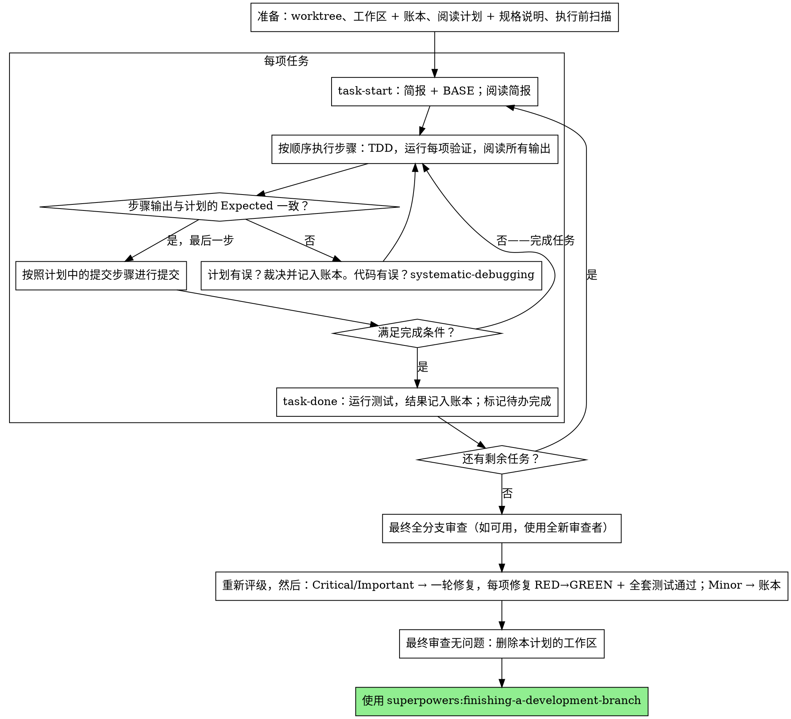

# 执行计划

在本会话中亲自逐个任务执行计划：不为每个任务分派实现者子 Agent，也不为每个任务安排审查者。最后，使用全新上下文对整个分支进行一次审查。

**为什么采用内联执行：**子 Agent 驱动开发需要为每个任务配备一个上下文全新的实现者和一个上下文全新的审查者，两者都要从零开始重新阅读代码库。内联执行只需为一个上下文（你的）以及最后的一位审查者付出成本。它放弃的是每个任务的全新上下文，以及每个任务的第二双眼睛。本技能通过其他方式保留这两者带来的价值：简报就是规格说明，进度账本就是你的记忆，TDD 是每个任务的关卡，而最终审查者就是第二双眼睛。

**核心原则：**计划已经完成了思考。严格执行它，用你亲眼看到先失败、后通过的测试证明每一步，并留下即使你自己忘记也依然存在的记录。

**过程叙述：**在工具调用之间，最多说一句简短的话——进度账本和工具结果承担记录的职责。

**连续执行：**不要在任务之间暂停，向你的人类伙伴确认。他们选择内联执行是为了减少花费，而不是在每个任务之后回答“我应该继续吗？”。不中断地执行计划中的所有任务。

**作出裁决，而非停滞。**冲突、歧义、计划缺陷——对它们作出决定。规格说明是具有约束力的权威依据，计划是基于它的论证，而两者都没有回答的问题由你的判断来解决。将每个决定以 `Ruling: <你的决定> — <原因> — <如果判断错误的代价>` 的形式记录到进度账本中，然后继续。偏离计划却没有在进度账本中记录裁决，就是私下作出的决定。

只有以下四种情况会让你停止：不可逆或破坏性的操作；涉及安全的操作；规范要求先询问的、发生在此工作树之外的副作用（合并、推送到共享分支、发布）；以及计划严重损坏，以至于任何前进路径都只能靠猜测。遇到这些情况时，停止并询问。

## 使用时机

- 你有一份来自 superpowers:writing-plans 的计划，并且你的人类伙伴在交接时选择了内联执行。
- 你的运行环境没有子 Agent 工具（参阅 `../using-superpowers/references/` 中各平台对应的参考文档）。绝不要伪造分派；就在这里执行计划。
- 任务大多相互独立——与 superpowers:subagent-driven-development 的前提条件相同。

一份完整明确的计划，会让内联执行变成照着计划实现并测试：它在中档会话模型上也能运行良好，而最强模型唯一值得付出额外成本的地方是最终审查，本技能会单独分派这项审查。当你的人类伙伴选择内联执行时，告诉他们这一点。

如果你的人类伙伴希望每个任务都有审查关卡，或者计划长到后面的任务会在经过压缩的上下文中执行，应优先使用 superpowers:subagent-driven-development。内联执行长计划仍然可行——进度账本让它能够恢复——但最后的任务能从你这里获得的能力支持最少。

## 流程



## 准备工作

确保工作在隔离的工作区中进行：使用 superpowers:using-git-worktrees 创建一个，或验证现有工作区。未经你的人类伙伴明确同意，绝不要在 main/master 分支上开始实施。

对话记忆无法在上下文压缩后保留下来。内联执行者一旦丢失进度位置，就会重新实现那些已经有提交的任务——这与控制者重新分派这些任务是同一种失败，只是成本由你自己的上下文承担。在进度账本文件中跟踪进展，而不是只用待办事项。运行环境中的待办事项是实时视图；进度账本才是记录。

工作区和进度账本与 superpowers:subagent-driven-development 共享——相同的目录，相同的格式——因此，计划可以在执行途中更换执行者，新执行者能从同一份进度账本接着执行。

- 每份计划都有自己的工作区：在技能启动时，运行 `../subagent-driven-development/scripts/sdd-workspace PLAN_FILE`——它会打印该计划被 git 忽略的目录（`<repo-root>/.superpowers/sdd/<plan-basename>/`），本计划的所有产物都放在这里：进度账本、简报、审查包。其他计划的目录绝不属于你的读写范围。
- 在 `<workspace>/progress.md` 检查本计划的进度账本。如果第一行指定的是你的计划文件，那么带有 `Task <N>: complete` 行的任务就是 DONE——不要重做；从第一个没有该行的任务继续。即使你的上下文已经不记得创建过那些提交，它们仍然存在于 git 中：在上下文压缩后，相比自己的回忆，应相信进度账本和 `git log`。如果进度账本第一行指定的是另一份计划文件，那就是其他计划的进度：不要动它，重新创建你自己的进度账本。
- 创建进度账本，并将其身份标识作为第一行：`# SDD ledger — plan: <plan file path>`。
- `git clean -fdx` 会摧毁工作区（它是被 git 忽略的临时存储区）；如果发生这种情况，从 `git log` 恢复。

阅读计划一次，记下它的上下文和全局约束，并为每个任务创建一个待办事项。如果计划指定了规格说明，也要阅读它：规格说明是计划据以论证的权威依据，计划内部的冲突要依据它来解决。如果计划没有可访问的规格说明，在进度账本中记下这一点——没有规格说明时作出的裁决都是暂定的。

**必需的子技能：**现在就加载 superpowers:test-driven-development，必须在任务 1 之前完成。它约束下面每个任务的每一步；即使计划中的步骤已经写明“先编写失败的测试”，也不能免除你阅读它的义务。

在任务 1 之前，扫描计划中任务之间的冲突。计划的接口块会告诉你该查看哪里：对于每个使用了前面任务产出的任务，在进度账本中写一条记录——涉及的两个任务、一方的产出与另一方的使用要求之间的对照，以及你的发现。没有共享内容的任务不写记录；如果整份计划的任务都没有共享内容，只写一行 `Pre-flight: no shared interfaces`。以规格说明为具有约束力的权威依据，对每条记录揭示的冲突作出裁决，将裁决记录在对应记录旁边，然后开始任务 1。每个任务自身的文本在阅读其简报时检查，而不是在这里检查。

## 任务循环

你打印的所有内容，以及每个工具结果，都会在本会话剩余时间里常驻于你的上下文。将冗长的测试输出重定向到工作区中的文件，并读取其末尾；阅读简报，而不是整份计划。

### 1. 接手任务

- 运行本技能的 `scripts/task-start PLAN_FILE N`。它会在一次调用中打印简报路径和 BASE（用于划定该任务提交范围的起始提交）。每个任务都要阅读简报，包括那些你在准备阶段就记得的任务：你记得的是摘要，简报中才有准确的值、签名和测试用例。
- 将该任务的待办事项标记为 in_progress。

每次工具调用都是一个会重新读取你全部上下文的轮次。记账要与工作一起进行——在提交的同一次调用中追加进度账本，绝不为追加进度账本单独发起调用。

### 2. 执行步骤

计划的步骤已经按照 RED-GREEN 的顺序排列；在准备阶段加载的 superpowers:test-driven-development 约束下，按该顺序执行。测试步骤的代码要先编写、先运行。亲眼看到它失败是一个步骤，而不是走过场——在实现尚不存在时就通过的测试，说明测试本身有值得注意的问题。

每个运行命令的步骤都有一行 `Expected:`。运行命令，阅读输出，并进行比较。有三种结果：

- **符合预期。**进入下一步。
- **代码有误。**使用 superpowers:systematic-debugging。找出原因；绝不要为了让步骤的输出符合预期而只修补症状。
- **计划有误**——某个步骤与规格说明冲突、前面任务提供的接口与本任务使用的接口不匹配，或某条命令根本无法运行。对满足规格说明的最小改动作出裁决，以 `Task <N>: Ruling: <发现> — <你的决定及原因>` 的形式记入进度账本，然后继续。裁决靠记录传递，而不是靠记忆：后续涉及同一接口的任务要从进度账本中读取它。

按照计划中的提交步骤进行提交。一个任务跨越多个提交没有问题；审查范围始终以 BASE 为起点，绝不是 `HEAD~1`。

### 3. 完成契约

在写入任务的进度账本行之前，以下所有条件都必须成立，并且在本会话中有证据——不能因为 diff 看起来正确就推断它们成立：

- 简报指定的每个测试都已存在，并在本任务中运行过，而且你已阅读输出。
- 该任务的最后一次测试运行已通过——`task-done` 就是这次运行，它会将命令和结果写入进度账本行。
- 简报中的每一行 `Expected:` 都已与实际输出进行比较。
- 每一处偏离简报的地方，都在进度账本中有一行 `Ruling:`。

**必需的子技能：**superpowers:verification-before-completion 约束这一完成声明。如果缺少任何一项，任务就尚未完成：把它完成。

### 4. 完成任务

运行本技能的 `scripts/task-done PLAN_FILE N BASE -- <test command>`，使用简报为整个任务指定的测试命令。它会运行测试，将完整输出保存在工作区中，打印末尾内容，并且——只有测试通过时——才向进度账本追加完成行：

`Task <N>: complete (commits <base7>..<head7>, tests: <command> → <result>)`

失败的运行不会记录任何内容；任务尚未完成。当它写入记录后，将待办事项标记为完成，并接手下一个任务。

## 最终审查

运行 `../subagent-driven-development/scripts/review-package PLAN_FILE MERGE_BASE HEAD`（MERGE_BASE = 分支开始时的提交，例如 `git merge-base main HEAD`），并依据它打印出的文件进行审查。

**有子 Agent 工具时：**使用可用的最强模型分派审查者——整个分支的审查是一项判断任务——并使用 superpowers:requesting-code-review 的 [code-reviewer.md](../requesting-code-review/code-reviewer.md)，提供审查包路径、计划和规格说明路径、计划的审查重点章节原文（如果有；其中列出了计划的测试没有覆盖的输入类别和失败模式——审查者要有意识地逐项检查），以及指向进度账本中 `Ruling:` 行的位置，让它能够权衡你作出的决定。明确指定模型；省略模型会继承会话所用的模型，而它未必是最强的。这是整个执行过程唯一付费获得的全新上下文。不要跳过它，也不要用你自己阅读 diff 来替代它。

**没有子 Agent 工具时：**阅读 code-reviewer.md，并亲自针对审查包执行该审查，在最后一个任务的进度账本行之后，作为独立的一轮审查进行。将 `Final review: self-review (no subagent tool)` 写入进度账本，并在最终消息中说明这一点：作者的自我审查弱于一位上下文全新的审查者，你的人类伙伴要在合并之前决定这是否足够。

在对任何发现采取行动之前，先将它们分类。审查者的严重程度标签只是建议；关卡由你把守。它的“不予评判”列表也归你处理：其中的每一行都需要你作出裁决并记入进度账本，与计划冲突完全一样——`Final: Ruling: <审查者暂不评判的行为> — <一个理性的人使用此软件时会得到什么，以及为何维持现状或为何现在将其视为问题> — <判断错误的代价>`。首先按影响重新评级：规格说明是一份愿景文档，一项发现的等级取决于它随软件交付后，一个理性的人使用此软件时会得到什么，而不是规格说明是否列出了触发它的输入——如果审查者因为规格说明没有提及而将某项发现定为 Minor，它评的是规格说明，而不是影响。然后：

- **Critical 和 Important** 进入修复轮次。
- **Minor** 以 `Final: minor (deferred): <一句话说明>` 的形式记入进度账本，并放到最终消息的“暂缓处理的 Minor 问题”下。Minor 问题绝不进入修复轮次，也绝不成为裁决——裁决是对冲突作出的决定，而不是你拒绝一项润色建议的备注。

亲自修复 Critical 和 Important 问题——你在这里就是实现者——只进行一轮修复。每项修复都由 TDD 验证，而不是由第二位审查者验证：编写能够复现该问题的测试，亲眼看到它失败，让它通过，然后运行整个测试套件。将每项修复以 `Final: fixed <问题> — <测试名称> RED→GREEN, suite <N>/<N>` 的形式记录到进度账本中。如果没有先失败的测试，修复就未得到验证；如果这一轮之后测试套件没有全部通过，那么这一轮就尚未结束。不要分派复审：它会重新阅读一个 diff，而覆盖该 diff 的测试已经回答了“已处理”，测试套件的运行也已经回答了“没有破坏其他功能”。

你决定不修复的发现是一项裁决——`Final: Ruling: <问题> — <为何保留现有代码> — <判断错误的代价>`——并会通过裁决列表传达给你的人类伙伴。没有第二轮修复。

## 收尾

在删除任何内容之前，将进度账本中包含 `Ruling:` 的每一行收集到最终消息的“我作出的裁决”下，按你作出裁决的顺序排列，每项都包含判断错误的代价；将每一行 `minor (deferred)` 收集到“暂缓处理的 Minor 问题”下。这两个列表都必须完整无遗漏。最终消息是你代表人类伙伴作出的决定——以及你选择不采取行动的发现——传达给他们的唯一地方。

当最终审查没有遗留问题且修复都已提交后，删除本计划的工作区目录——现在 git 历史就是记录。相邻目录属于其他计划；不要动它们。

使用 superpowers:finishing-a-development-branch。

## 常见的合理化借口

| 借口 | 现实 |
|--------|---------|
| “我记得任务 N 写了什么” | 你记得的是摘要。简报中才有准确的值。阅读它。 |
| “计划中的代码是对的，不用看测试失败” | 一个你从未看到失败的测试，什么也证明不了。这是一个步骤。运行它。 |
| “我会在最后运行完整测试套件，而不是每一步都运行” | 逐步运行才能知道是哪一步破坏了它。任务结束时的运行是契约，不是替代品。 |
| “计划这里有误，我直接做正确的事就行” | 做正确的事，并将裁决记入进度账本。没有记入进度账本的偏离，就是私下作出的决定。 |
| “我会在几个任务之后再写进度账本行” | 上下文压缩不会等待方便的时机。每个任务一行，与提交放在同一条消息中。 |
| “让我在下一个任务之前确认一下” | 他们选择内联执行是为了减少花费。进度询问反而会花费他们的时间。只有那四种停止条件才会让你停止。 |
| “我仔细读过自己的 diff；最终审查者是多余的” | 同一个作者，同样的盲点。审查者是本次执行唯一获得的全新上下文。 |
| “测试应该会通过，改动很小” | “应该”不是证据。契约要求命令及其输出。 |
| “子 Agent 又慢又贵，我也跳过最终审查吧” | 内联执行已经去掉了每个任务的审查者。对整个分支进行一次审查是下限，不是上限。 |
| “审查者说是 Minor，那就是 Minor” | 这个标签评的是规格说明没有提及。评估使用者实际会得到什么。先重新评级，再把关。 |
| “修复很明显，不需要先写失败的测试” | 失败的测试是证明该问题确实存在且现在已消失的唯一证据。没有它，你只有一个 diff 和一个希望。 |
| “既然在改了，我顺便把 Minor 问题也修掉” | 你修复的每个 Minor 问题，都意味着一次测试、一次修复和一次测试套件运行，而你的伙伴并没有要求这些。记入进度账本；由你的伙伴决定。 |

## 工作流示例

```
你：我正在使用 executing-plans 技能以内联方式实施此计划。

[准备工作：已验证工作树]
[阅读计划一次：docs/superpowers/plans/feature-plan.md；已阅读规格说明]
[确定工作区：sdd-workspace docs/superpowers/plans/feature-plan.md — 其中没有进度账本，从头开始]
[执行前扫描：2 条共享接口记录，4 条自洽性记录，未发现问题；已写入进度账本]
[为所有任务创建待办事项]

任务 1：Hook 安装脚本

[task-start plan 1 → 已阅读简报；BASE a1b2c3d]
[步骤 1：编写失败的测试 — 已编写]
[步骤 2：运行测试 — FAIL: install_hook 未定义。符合 Expected。]
[步骤 3：实现 — 已编写]
[步骤 4：运行测试 — PASS 1/1。符合 Expected。]
[步骤 5：提交 — d4e5f6a]
[完成契约：测试已运行，输出已阅读，没有偏离]
[task-done plan 1 a1b2c3d -- npm test -- hooks → 进度账本：Task 1: complete (commits a1b2c3d..d4e5f6a, tests: npm test -- hooks → 1/1 pass)]

任务 2：恢复模式

[task-start plan 2 → 已阅读简报；BASE d4e5f6a]
[步骤 2：运行失败的测试 — FAIL，但原因是导入错误：任务 1 导出了
 installHook，简报使用的却是 install_hook]
[Ruling: 对照任务 1 的 Produces 块，简报中的消费方名称是笔误；
 使用 installHook — 进度账本：Task 2: Ruling: install_hook → installHook — 与任务 1 的 Produces 一致 — 判断错误的代价：重命名一次]
[步骤 2-5 按计划执行；提交 b7c8d9e]
[task-done plan 2 d4e5f6a -- npm test -- recovery → 进度账本：Task 2: complete (commits d4e5f6a..b7c8d9e, tests: npm test -- recovery → 8/8 pass)]

...

[所有任务完成后：review-package plan MERGE_BASE HEAD；使用最强模型分派 code-reviewer]
审查者：一项 Important 问题——进度报告间隔被硬编码。两项 Minor 问题。
[重新评级：Important 评级保持不变；Minor 问题 → 以暂缓处理的形式记入进度账本]
[修复轮次：test_progress_interval_configurable RED → 提取 PROGRESS_INTERVAL → GREEN；测试套件 12/12；提交]
[进度账本：Final: fixed 硬编码的间隔 — test_progress_interval_configurable RED→GREEN, suite 12/12]

我作出的裁决：
- Task 2: install_hook → installHook（简报中的笔误；判断错误的代价：重命名一次）

暂缓处理的 Minor 问题：
- README 缺少使用示例
- recovery.js 可以将 verify/repair 拆分到两个文件中

[删除本计划的工作区——记录现在保存在 git 中]

使用 superpowers:finishing-a-development-branch。
```
